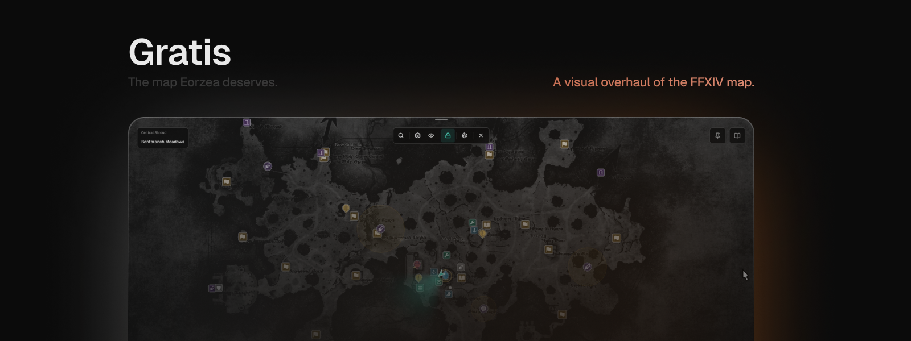
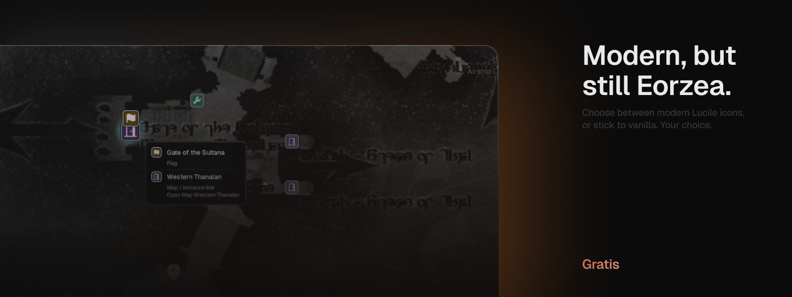

<div align="center">



<br>


[Install](#install) · [Features](#features) · [Commands](#commands) · [Feedback and bugs](#feedback-and-bugs) · [Credits](#credits)

</div>

<br>

Gratis reimagines the XIV map with a focus on customization, QoL tweaks across the board, a powerful search palette and an an integration of the quest log.

## Install

Gratis is in the official Dalamud plugin repository's **testing** channel, so you need to opt in to testing builds once.

1. In game, open `/xlsettings`, then Experimental, and tick **Get plugin testing builds**. Save.
2. Open `/xlplugins`, search for Gratis and install it.
3. If you run another map replacement plugin, disable it so the two do not fight over the map.

Updates arrive through the normal plugin installer. Testing builds can have bugs, so please report anything odd (see [Feedback and bugs](#feedback-and-bugs)).

**Installed Gratis from the old custom repository?** Remove this URL from `/xlsettings`, Experimental, Custom Plugin Repositories, so you do not get two copies of the plugin - the custom repo will **no longer be receiving support**:

```
https://raw.githubusercontent.com/t3sco/Grat...
```

Open the map with `/gratis map` or your usual map key. The Quest Log button is at the top right of the map.

## Features

- **Search:** find any zone, aetheryte, quest, marker or NPC. Results show the distance, whether you are attuned and what the teleport costs. No longer are you expected to know where everything is from the get-go.
- **Browse:** no particular location in mind? Browse through the entirety of XIV by expansion, zone and quest.
- **A modernised, standardised UI:** optimised for ease of access and built to be endlessly resizable with responsive scaling.
- **Remembers your view:** each zone keeps its own view, and small areas and raid arenas fit automatically. Dragging the map no longer interrupts following your character - a short delay and it springs back. Maps update on zone change so you aren't left in an old map after a teleport.
- **Markers:** quests, FATEs, flags, aetherytes and your party are always shown. Lenses allow you to build presets for gathering, raiding, questing and more without cluttering your map.
- **Quest Log:** browse Accepted, Completed and Available quests beside the map, with details and rewards. It can replace the game's Journal - inspired by World of Warcraft.
- **Travel:** see whether an aetheryte is attuned and what the trip costs. Gratis starts the teleport but never moves your character. Wayfinding a quest will suggest the nearest aetheryte automatically.
- **Settings:** simple toggles, five window presets, colour presets, a circular map, and a Classic look if you prefer the old one. Every single element of the map can be tuned to your liking.

<br>



## Roadmap

- **Aethernet:** A complete rework of the aethernet selector map UI to bring it in-line with Gratis.
- **Custom Map Artwork:** Replace splash imagery with your own artwork in the search palette.
- **Accepting Suggestions:** I want to hear from you! This plugin is built for the community. Have an idea? Suggest using the speech icon in the bottom left of the map.

<br>


https://github.com/user-attachments/assets/7c1cd5d7-6b8c-4117-a95a-717118950f92


## Feedback and bugs

This is an early build and has rough edges.

- **Found a bug?** Run `/gratis report`, then open an issue or message me with the saved file and what you saw.
- **Quick message:** use the speech-bubble button in the bottom-left of the map. Nothing is sent until you press Send, and only your message and the Gratis version go. Tick "Include a diagnostic report" to add the same report as `/gratis report` (no character name or chat). You can turn the button off under Settings > Feedback button.

## Credits

- [Mappy](https://github.com/harbingerftw/Mappy), by MidoriKami (original author) and harbingerftw (maintainer of the
  fork this is based on, version 3.2.0.0). The map window, marker handling and plugin structure come from their work.
- KamiLib and MappyLib, by MidoriKami and contributors. The parts Gratis needs are copied into its own source with their licence kept.
- [Geist](https://github.com/vercel/geist-font) by Vercel (SIL Open Font License), Noto Sans CJK by Adobe and Google (SIL Open Font License, preview harness only), [Lucide](https://lucide.dev) icons
  by Lucide Contributors (ISC) and [Phosphor](https://phosphoricons.com) icons by Phosphor Icons (MIT).
- Dalamud (goatcorp), FFXIVClientStructs and Lumina, which Gratis is built against.

[NOTICE.md](NOTICE.md) has the full list, with licences and what is derived from what.

FINAL FANTASY XIV is a registered trademark of Square Enix. Gratis is a fan project and is not affiliated with
or endorsed by Square Enix. Screenshots contain game artwork copyright Square Enix.

Licensed under AGPL-3.0. See [LICENSE](LICENSE) and [NOTICE.md](NOTICE.md).
