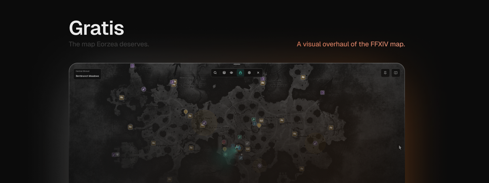
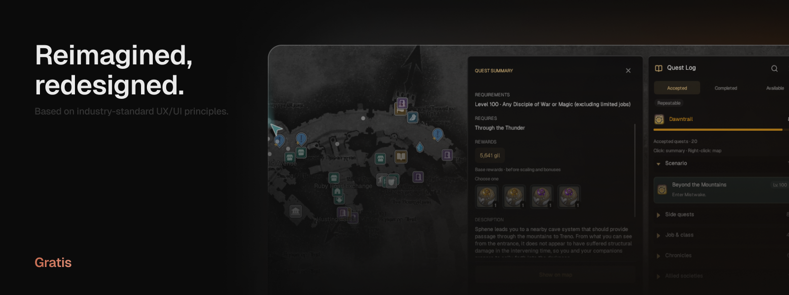
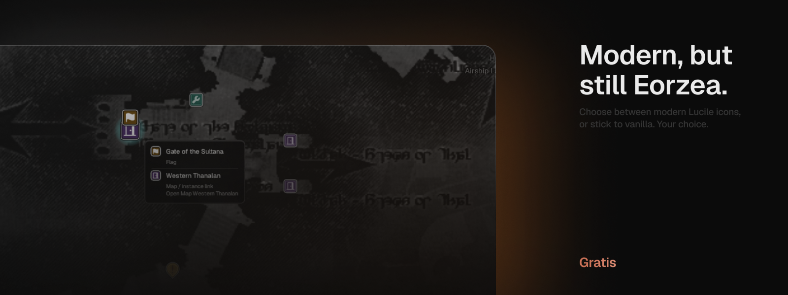

<div align="center">



<br>


[Install](#install) · [Features](#features) · [Commands](#commands) · [Feedback and bugs](#feedback-and-bugs) · [Credits](#credits)

</div>

<br>



<br>

Gratis keeps the game's maps and replaces the interface around them: a flat glass look in warm gold and crystal blue, fast search, and an optional Quest Log.

## Install

Gratis is in early testing and is not in the official Dalamud repository yet.

1. In game, open `/xlsettings`, then Experimental, then Custom Plugin Repositories.
2. Add this URL, tick Enabled and save:

   ```
   https://raw.githubusercontent.com/t3sco/Gratis/master/repo.json
   ```

3. Open `/xlplugins`, search for Gratis and install it.
4. If you run another map replacement plugin, disable it so the two do not fight over the map.

Open the map with `/gratis map` or your usual map key. The Quest Log button is at the top right of the map.

## Features

- **Search:** find any zone, aetheryte, quest, marker or NPC. Results show the distance, whether you are attuned and what the teleport costs.
- **Browse:** leave the box empty to browse by expansion, and use the keyboard throughout.
- **Glass interface:** the map fades away when you are not using it, with smooth animation you can turn down or off.
- **Remembers your view:** each zone keeps its own view, and small areas and raid arenas fit automatically.
- **Markers:** quests, FATEs, flags, aetherytes and your party are always shown. Six lenses and a filter drawer clear a busy zone.
- **Quest Log:** browse Accepted, Completed and Available quests beside the map, with details and rewards. It can replace the game's Journal.
- **Travel:** see whether an aetheryte is attuned and what the trip costs. Gratis starts the teleport but never moves your character.
- **Settings:** simple toggles, five window presets, colour presets, a circular map, and a Classic look if you prefer the old one.

Not done yet: abandoning and tracking quests from the Quest Log.

<br>



## Commands

| Command | What it does |
| --- | --- |
| `/gratis` | Open settings |
| `/gratis map` | Open or close the map |
| `/gratis report` | Save a report to attach to a bug report (no character names) |

<br>


https://github.com/user-attachments/assets/7c1cd5d7-6b8c-4117-a95a-717118950f92


## Feedback and bugs

This is an early build and has rough edges.

- **Found a bug?** Run `/gratis report`, then open an issue or message me with the saved file and what you saw.
- **Quick message:** use the speech-bubble button in the bottom-left of the map. Nothing is sent until you press Send, and only your message and the Gratis version go. Tick "Include a diagnostic report" to add the same report as `/gratis report` (no character name or chat). You can turn the button off under Settings > Feedback button.

## Credits

- [Mappy](https://github.com/harbingerftw/Mappy), by MidoriKami (original author) and harbingerftw (maintainer of the
  fork this is based on, version 3.2.0.0). The map window, marker handling and plugin structure come from their work.
- KamiLib and MappyLib, by MidoriKami and contributors. The parts Gratis needs are copied into its own source with their licence kept.
- [Geist](https://github.com/vercel/geist-font) by Vercel (SIL Open Font License), Noto Sans CJK by Adobe and Google (SIL Open Font License, preview harness only), [Lucide](https://lucide.dev) icons
  by Lucide Contributors (ISC) and [Phosphor](https://phosphoricons.com) icons by Phosphor Icons (MIT).
- Dalamud (goatcorp), FFXIVClientStructs and Lumina, which Gratis is built against.

[NOTICE.md](NOTICE.md) has the full list, with licences and what is derived from what.

FINAL FANTASY XIV is a registered trademark of Square Enix. Gratis is a fan project and is not affiliated with
or endorsed by Square Enix. Screenshots contain game artwork copyright Square Enix.

Licensed under AGPL-3.0. See [LICENSE](LICENSE) and [NOTICE.md](NOTICE.md).
